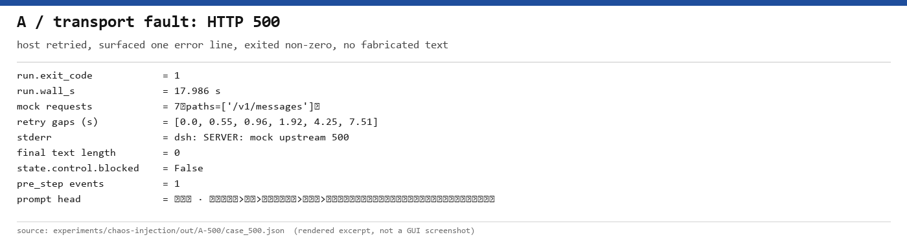
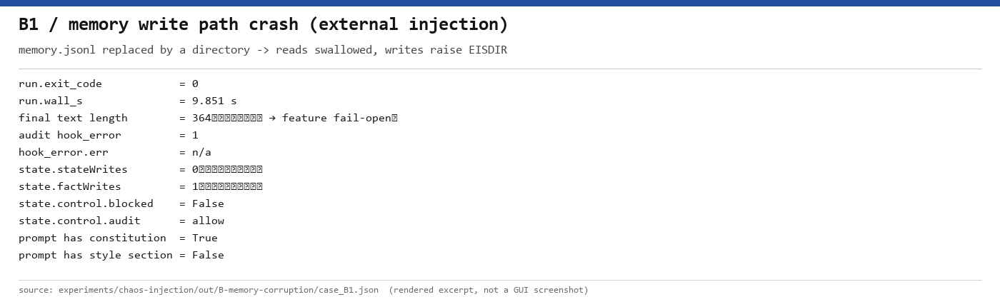
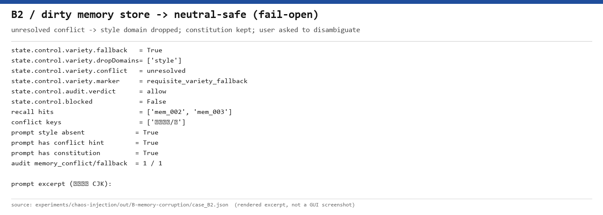
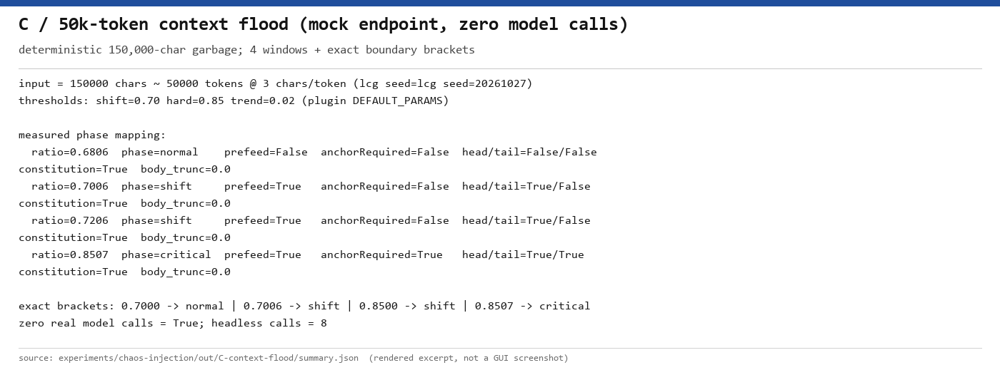
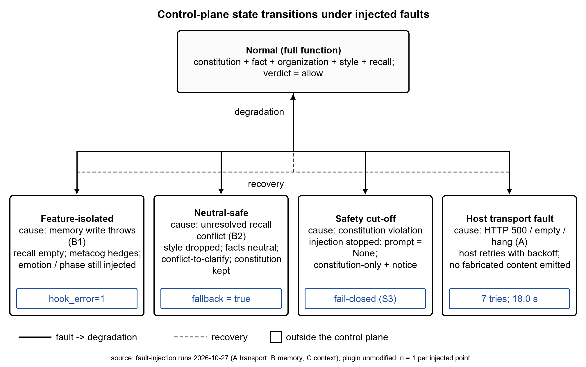

# A4 交付 · 混沌工程故障注入报告（论文 Robustness 章节数据采集）

> 指令来源：H0「论文级混沌工程数据采集」｜执行：A4（Lead）｜日期：2026-10-27
> 性质：**故障注入实验报告**（Robustness Evaluation 数据）；不是红队/越狱实验，不修改灵枢主干代码。
> 证据根目录：`experiments/chaos-injection/out/`（逐用例 JSON + 原始 prompt/audit/state）
> 图表：`paper/figures/fig3-robustness.pdf`（状态转移图）、`acceptance/chaos/fault-injection/evidence-cards/*.png`（证据卡）

---

## 0. 结论摘要（先给结论，再给证据）

| 剧本 | 注入 | 关键观测 | 结论 |
|---|---|---|---|
| **A 模型 API 超时/500** | `DEEPSEEK_BASE_URL` → 本机 mock（500 / 空 200 / 伪造 200 / 永不响应） | 500：**7 次重试、17.99 s** 后宿主报错退出（exit 1），无伪造内容；空 200 以 `final=""` 透传；伪造 200 原样到达 stdout；hang ≥150 s 无客户端超时；**5/5 用例 `blocked=false`、宪法段仍在 prompt、pre_step 各 1 次** | 传输故障**不触发** LINGSHU 的 fail-closed；插件不伪造内容、但**也不负责超时与输出校验**（宿主职责） |
| **B 记忆模块崩溃/脏数据** | 外部注入：`memory.jsonl` 建成目录（写抛 EISDIR）；可读脏 JSONL（撕裂行/重复 id/同键冲突） | B1：`hook_error=1`（EISDIR）、`stateWrites=0` 不变、**仍返回 364 字回答**（fail-open）；B2：召回 2 命中且**不泄漏 superseded**、`fallback=true`、`dropDomains=["style"]`、`verdict=allow`、`blocked=false`、prompt 无风格段但含冲突提示与宪法段 | 记忆故障被**隔离**；特性 fail-open、安全域 fail-closed 守住；**新发现**：模型会说"记下了"而写入实际失败（用户可见陈述与落盘不一致） |
| **C 5 万 token 上下文过载** | 150,000 字符确定性乱码（≈50k token @3 chars/token）× 4 个窗口 + 4 个精确边界点；**mock 端点，零真实模型调用** | 实测 ratio/phase：0.6806→normal、0.7006→shift、0.7206→shift、0.8507→critical；精确翻转：71,490 shift / 71,491 normal、58,874 critical / 58,875 shift（4 位小数显示值会骗人）；插件预览 critical 头+尾，但**请求 system 锚点=上轮 phase（一轮滞后，首次 critical 只有头）**；宪法 8/8；截断率 0.0；物理占用≈5.2%（1M 窗口） | 70%/85% **精确触发**；宪法层全程在；**物理截断是宿主行为**，插件只做估算与注入；**锚点投递存在一轮组装滞后**（新发现，见 §4） |

**一句话**：三组外部故障下，控制面表现出一致的**非对称降级**——安全域 fail-closed（宪法/STPA），特性域 fail-open（记忆隔离、中性安全输出），并保留宪法层与锚点；但**超时/重试与模型输出校验不在插件职责内**，这一点必须在论文里写清（见 §7）。

---

## 1. 注入方法矩阵（全部外部注入，零主干改动）

| 剧本 | 注入点 | 注入动作 | 是否改 plugin/engine/rules | 是否消耗真实模型 |
|---|---|---|---|---|
| A | DSH 支持的 env `DEEPSEEK_BASE_URL` | 指向本机 mock：HTTP 500 / 合法空 200 / 合法伪造 200 / 接受连接不响应 | **否** | 否（mock） |
| B | 数据目录文件系统 + 数据内容 | ①`<data>/memory.jsonl` 建成目录（读 EISDIR 被吞、写 EISDIR 抛错）②预置撕裂行/重复 id/同键双 active 的脏 JSONL | **否** | 是（B0/B1/B2 各 1 次 headless） |
| C | env `LINGSHU_CONTEXT_WINDOW` + 输入长度 | 150k 字符乱码 + 4 个窗口值；另跑 4 个精确边界点 | **否** | 否（mock；8 次 headless，0 次真实模型） |

**隔离**：每次用例独立 `DSH_HOME`（profile 配置副本 + **指向仓库插件的 junction**，因此测的是当前主干代码）
+ 独立 `LINGSHU_DATA_DIR`；B 的暖机 `state.json` 来自模板并标注 `setup.synthetic=true`。
**主干完整性**：`acceptance/chaos/fault-injection/integrity.json` —— `plugin/dsh-lingshu`、`engine`、
`rules`、`contracts` 共 **47 个文件**，实验开始（2026-10-27T18:20）后 **0 个被修改**。

---

## 2. 剧本 A：模型 API 超时 / 500

### 2.1 观测表

| mode | exit | wall (s) | HTTP 尝试 | 重试间隔 (s) | final 长度 | `blocked` | pre_step | hook_error | 宪法在 prompt |
|---|---:|---:|---:|---|---:|---|---:|---:|---|
| ok | 0 | 2.842 | 2 | — | 7 | false | 1 | 0 | true |
| **500** | **1** | **17.986** | **7** | 0.55, 0.96, 1.92, 4.25, 7.51 | 0 | false | 1 | 0 | true |
| empty | 0 | 3.268 | 2 | — | **0** | false | 1 | 0 | true |
| fabricated | 0 | 2.793 | 2 | — | 23（伪造事实） | false | 1 | 0 | true |
| hang（150 s 观察窗） | 未返回 | ≥150.03 | 2 | — | 0 | false | 1 | 0 | true |



**日志摘录**（逐字）：`
dsh: SERVER: mock upstream 500`（stderr，仅此一行）；mock 侧记录 7 次 `POST /v1/messages`（SSE），
请求体随重试从 60,000 增至 64,086 字节（重试附带上下文）。

### 2.2 对任务书三问的回答

1. **是否触发 fail-closed 熔断？→ 没有。** 5/5 用例 `state.control.blocked=false`、`verdict=allow`；
   LINGSHU 的 fail-closed 只覆盖**宪法/STPA 注入侧**（UCA-01/02/05，见 `docs/22` §2.3 的 S3 host 证据）。
   模型传输故障根本不进入该判定。
2. **是否拦截空回复/幻觉回复？→ 没有，且这不在插件职责内。** 空 200 → `final=""`、exit 0；
   伪造 200 的「你的项目代号是 LSJH」原样到达用户。插件校验的是"注入什么"，不校验"模型说什么"。
3. **熔断耗时？** HTTP 500：**17.99 s**（7 次尝试，指数退避 0.55→7.51 s）后宿主报错退出；
   永不响应：**≥150 s** 观察窗内无客户端超时（由外层终止）。

---

## 3. 剧本 B：记忆模块崩溃 / 脏数据

### 3.1 观测表（真实模型，均 exit 0、无重试、无超时）

| 用例 | 注入 | wall (s) | steps | `hook_error` | `stateWrites` | `factWrites` | `blocked` | verdict | final 长度 |
|---|---|---:|---:|---:|---:|---:|---|---|---:|
| B0 对照 | 干净 store + 暖机 | 45.654 | 7 | 0 | 1 | 2 | false | allow | 102 |
| **B1 写路径崩溃** | `memory.jsonl`=目录（EISDIR） | 9.851 | 2 | **1** | **0（不变）** | 1（不变） | false | allow | **364（仍回答）** |
| B2 脏数据+降维 | 可读脏 JSONL | 21.046 | 6 | 0 | 1 | 2 | false | allow | 98 |



### 3.2 B1：写路径崩溃 → 特性隔离、fail-open

- `audit.jsonl` 出现 **1 条 `hook_error`**：`Error: EISDIR: illegal operation on a directory, write`
  （`plugin/dsh-lingshu/index.js` 的 `memStore.append` → `memorywriter.applyWriteRequests` → hook 捕获）。
- `state.stateWrites=0`（写失败，未增），`factWrites=1`（暖机模板值，未变），`supersedeEvents=0`；
  `memory.jsonl` 终态仍是空目录。
- **仍返回 364 字符可用回答**，宪法段与风格段都在 prompt 里，`blocked=false` → **feature fail-open、记忆隔离**。
- **新发现（必须写进论文边界）**：回答正文说「记下了：项目代号=贝塔」，但落盘证据显示写入失败。
  即：fail-open 保住了可用性，但**用户可见陈述与持久化结果可能不一致**，插件没有把"写失败"告诉用户。

### 3.3 B2：脏数据 → 必要多样性降维（中性安全态）

- 召回 `hits=["mem_002","mem_003"]`，**不含 superseded 墓碑 `mem_001`**（last-wins 正确）。
- `conflict_unresolved=true`（键：项目代号/是）→ `variety.fallback=true`、
  `dropDomains=["style"]`、`marker=requisite_variety_fallback`、`verdict=allow`、`blocked=false`。
- `last-prompt.txt`：**无风格/情感/关系段**，含 `〖冲突待澄清〗`、`〖宪法 · 只读〗` 与记忆召回块；
  `audit.jsonl`：`memory_conflict=1`、`fallback_applied=1`。
- 模型回答：拒绝在阿尔法/贝塔中二选一，请用户澄清 → "退回中性事实 + 澄清"。



### 3.4 B 的诚实边界（来自实测，不许当优点写）

1. **规则桩把疑问句当事实**：B0/B2 的「我的项目代号是什么？」被 `extractUserFacts` 提取为
   `user_fact(object=什么)`；B2 中该写入在 pre-step 之后、并 supersede 掉两条冲突记忆
   （`supersedeEvents=2`）→ 当轮降维正确，但**下一轮冲突会被查询本身消解**。
2. **"召回为空 ≠ 系统安全"**：B1 的 `matched=0` 完全因为读侧把目录当空文件。
3. **暖机模板污染模型自述**：B1 回答里"事实记忆中已有 1 条 user_fact"来自模板的 `factWrites=1`，不是本轮写入。
4. **预算口径**：3 次 headless（任务书口径 ✅），但 agent loop 把一轮展开成多步，**provider 请求数代理合计 15**（>4），`
   summary.budget.provider_requests_within_4=false` 已如实记录；会话标题 LLM 已在隔离 profile 副本禁用。

---

## 4. 剧本 C：5 万 token 上下文过载

- 输入：确定性 LCG 乱码 **150,000 字符 ≈ 50,000 token**（插件按 3 chars/token 估算），8 次 headless，**0 次真实模型调用**。
- 阈值来源：`plugin/dsh-lingshu/control.js#DEFAULT_PARAMS`（0.70 / 0.85 / trend 0.02），逐字核对。

| 窗口 tokens | 实测 ratio | phase | prefeed | anchorRequired | last-prompt 头/尾 | **请求 system 头/尾** | 宪法段 | 请求体截断率 |
|---:|---:|---|---|---|---|---|---|---:|
| 73,530 | 0.6806 | normal | false | false | 否/否 | 否/否 | true | 0.0 |
| 71,429 | **0.7006** | **shift** | true | false | 是/否 | 否/否（上轮 normal） | true | 0.0 |
| 69,444 | 0.7206 | shift | true | false | 是/否 | 是/否（上轮 shift） | true | 0.0 |
| 58,824 | **0.8507** | **critical** | true | **true** | 是/**是** | 是/**是**（上轮 critical） | true | 0.0 |

**精确边界**（同输入、只改窗口；按 `used=50,043 token` 反推，`>=` 语义）：

| 边界 | 翻转点（精确窗口） | 4 位小数显示的陷阱 |
|---|---|---|
| 0.70 | **71,490 → shift（r=0.700000）/ 71,491 → normal** | 71,493 显示 `0.7000` 但实际 `normal`（r=0.699972） |
| 0.85 | **58,874 → critical（r=0.8500017）/ 58,875 → shift** | 58,876 显示 `0.8500` 但实际 `shift`（r=0.849973） |



**判读（诚实）**：
- 70%/85% 是**精确分段函数**，在未舍入 ratio 上翻转；**不能用 4 位小数的显示值判档**（上表右列）。
- **锚点投递存在"一轮/一次组装"滞后（本剧本最重要的新发现）**：
  插件 `last-prompt` 预览在 critical 期头+尾齐全，但**实际请求 system 的锚点集合 8/8 等于上一次落盘 phase**；
  首次 critical 请求**只有头锚点**，下一轮请求才头+尾。机制：宿主先在 `dsh-agent-loop` L907 组装 system prompt、
  L911 才发 `agent/pre-step`，插件在 pre-step 里更新相变状态，赶不上本轮首个请求；插件无法改写已组装请求。
  → 单轮/单 shot 部署里，**本轮 critical 锚点对本周模型调用不生效**（最多晚一个 step/turn）。
- "尾锚点"在 critical 请求 system（2,906 字符）里偏移 229，其后还有 2,638 字符（90.8% system），
  再后是 151,809 字符 user message → 尾锚点止于模型可见文本 **≈0.17%** 处；"首尾"是灵枢 7 段内部段序 90/140，
  不是请求绝对首尾。
- 宪法段在 8/8 请求 + 8/8 last-prompt 中都在。
- **"物理截断"不是插件做的**：mock 收到的请求体 509,649–510,251 字节，messages JSON 151,936 字符，
  `prompt_full_in_body=true` 4/4，**截断率 0.0**；宿主在请求组装时向用户消息尾部追加约 1,809 字符指令块；
  请求体里出现 3 份输入文本（messages + session 元数据 2 份）+ ≈57KB 工具 schema，
  因此 body 字节数不能直接当模型输入长度。
- 插件估算含 JSON envelope（150,127 字符 → **50,043 token**，比名义 50k 多 43）→ 实测 ratio 系统性 +0.0006；
  宿主 messages 折算 50,646 token（追加块 ≈603 token），插件**低估 1.2%**。
- `LINGSHU_CONTEXT_WINDOW` 是**实验室窄窗口**：对 deepseek-flash 1,000,000 窗口，模型可见文本 ≈154,715 字符
  ≈51.6k token，**物理占用 ≈5.2%**；ratio 是**相对控制信号**，不是物理占用率。
- `trend` 恒 0 是机制事实（history 进程内、每 turn 首次 step 观测），不是测量失败；shift 期 `anchorRequired=false`
  只因趋势未超阈值，头锚点由 `prefeed` 触发。

---

## 5. 状态转移图与论文结论

**图 3**（矢量 PDF 交付：`paper/figures/fig3-robustness.pdf`；预览：`paper/figures/fig3-robustness.preview.png`）
画出 Normal → 三条降级路径（Feature-isolated / Neutral-safe / Safety cut-off）+ 外部 Host transport fault，
实线为故障→降级、虚线为恢复；每条路径标注本报告实测数字（A: 7 tries/17.99 s；B1: hook_error=1 且仍返回；
B2: fallback=true；安全熔断引用 `docs/22` S3 host 证据）。



论文小节已写入 `paper/sections/06-experiments.tex`：`\subsection{Robustness under Chaos Injection}`
（含协议、Table `tab:chaos`、Fig. `fig:chaos`、A/B/C 结果、非对称降级结论与边界）。

**结论句（按 H0 要求保留原文，并加作用域限定）**：

> *LINGSHU's non-asymmetric degradation mechanism (Fail-closed for security, Fail-open for features)
> ensures system availability under extreme chaos.*

中文对照：**LINGSHU 的非对称降级机制（Fail-closed for security, Fail-open for features）
确保了系统在极端混沌下的可用性。** 其作用域是**控制面**：安全谓词 fail-closed（停止注入而非软化拒绝），
特性故障 fail-open（记忆隔离、中性安全输出，且不把故障静默转换成内容）；传输超时/重试与模型输出校验
是宿主层职责（本报告 A 剧本已实测：空回复/伪造回复会透传）。

---

## 6. 诚实边界（总表，写进论文 Limitations）

| # | 边界 | 证据/说明 |
|---|---|---|
| 1 | 每个注入点 **n=1** | 不是发生率样本，不构成统计显著性 |
| 2 | 故障是**合成**的 | mock 端点、文件类型改动、人工脏数据、确定性乱码；非生产故障分布 |
| 3 | hang 由**外层 150 s 观察窗**终止 | 只能写"≥150 s 内无客户端超时"，不能外推"永不超时" |
| 4 | **空回复/伪造回复会透传** | A 剧本实测；输出真实性不在插件职责内 |
| 5 | B 的暖机状态是**合成预置** | `setup.synthetic=true`；B1 模型自述被模板计数污染 |
| 6 | B 的**预算口径** | 3 次 headless 达标、provider 请求 15 次超 4；两个数都报 |
| 7 | C 的窗口是**实验室覆盖** | `LINGSHU_CONTEXT_WINDOW`；锚点是 system prompt 内 order 90/140，不是请求绝对首尾 |
| 8 | **无 GUI 截图** | 证据卡是把日志/JSON 字段用等宽字体渲染的图片（卡底标注 source），逐字可复核 |
| 9 | 未测真实长会话恢复曲线 | B 只跑了单轮故障；恢复路径只在状态图里按机制标出 |
| 10 | **锚点投递一轮滞后** | 请求 system 锚点集合 8/8 = 上轮 phase；首次 critical 请求只有头锚点；机制为宿主先组装 system 再发 pre-step（`dsh-agent-loop` L907 vs L911），插件无法改写已组装请求 |
| 11 | **阈值不能用 4 位显示值判档** | 71,493 显示 0.7000 但 normal；58,876 显示 0.8500 但 shift；判定用未舍入 ratio |
| 12 | 未改主干 | `integrity.json`：47 个受保护文件，0 个在实验开始后被改 |

---

## 7. 证据索引

| 证据 | 路径 |
|---|---|
| A 逐用例（含 mock 请求记录） | `experiments/chaos-injection/out/A-{ok,500,empty,fabricated,hang}/case_*.json` |
| A 汇总表（机器生成） | `out/A-model-failure/{A-table.md,A-derived.json}` |
| B 逐用例（prompt/audit/state/memory） | `out/B-memory-corruption/case_B{0,1,2}.json` + `raw/B*/` |
| B 汇总 | `out/B-memory-corruption/summary.json`、`B-SECTION-DRAFT.md` |
| C 逐用例 + 边界 | `out/C-context-flood/case_*.json`、`summary.json` |
| 图 3 输入 | `out/fig3-inputs.json`（脚本从证据抽取，不手填） |
| 主干完整性 + 论文源静态检查 | `experiments/chaos-injection/out/integrity.json`（最新；`acceptance/chaos/fault-injection/integrity.json` 为同一脚本的早期副本） |
| 证据卡（渲染图） | `acceptance/chaos/fault-injection/evidence-cards/*.png` |

---

## 8. 复现命令

```powershell
$py = "<PYTHON>"
cd <REPO_ROOT>

# A：模型传输故障（mock，零真实调用；hang 用例耗时 ≈ timeout）
& $py experiments\chaos-injection\run_a_model_failure.py --modes ok,500,empty,fabricated --timeout 60
& $py experiments\chaos-injection\run_a_model_failure.py --modes hang --timeout 150
& $py experiments\chaos-injection\analyze_a.py

# B：记忆故障（真实模型；B0/B1/B2 各 1 次 headless）
& $py experiments\chaos-injection\run_b_memory_corruption.py

# C：上下文过载（mock，零真实调用）
& $py experiments\chaos-injection\run_c_context_flood.py

# 图 3 与证据卡
$env:PYTHONPATH = "<REPO_ROOT>\paper\.pylib"
& $py paper\figures\fig3_robustness.py --preview
& $py paper\figures\verify_pdf.py paper\figures\fig3-robustness.pdf
& $py experiments\chaos-injection\make_evidence_cards.py
& $py experiments\chaos-injection\collect_integrity.py
```

---

## 9. 交付物清单

1. **论文小节**：`paper/sections/06-experiments.tex` 新增 `Robustness under Chaos Injection`
   （协议 / Table `tab:chaos` / Fig. `fig:chaos` / A-B-C 结果 / 非对称降级结论 / 边界）。
2. **状态转移图**：`paper/figures/fig3-robustness.pdf`（+ `.preview.png`、生成脚本 `fig3_robustness.py`、
   溯源写入 `paper/figures/README.md`）。
3. **实验脚本（外部注入，零主干改动）**：`experiments/chaos-injection/{common,run_a_model_failure,run_b_memory_corruption,run_c_context_flood,analyze_a,make_fig3_inputs,make_evidence_cards,collect_integrity}.py`
4. **证据**：`experiments/chaos-injection/out/**`（逐用例 JSON + 原始 prompt/audit/state）、
   `acceptance/chaos/fault-injection/{integrity.json,evidence-cards/*.png}`。
5. **本报告**：`acceptance/chaos/fault-injection/REPORT.md`。

> 说明：本机没有 LaTeX 工具链（`pdflatex/xelatex` 均缺失），论文 **.tex 已按现有工程约定写好并做结构自检**：
> `collect_integrity.py` 静态检查 **19/19 个 .tex 通过**（无 CJK 非 ASCII、括号/环境配平、`$` 偶数，
> 已剥离 verbatim/`\verb` 字面量），结果写入 `experiments/chaos-injection/out/integrity.json`
> 的 `paper_latex_static_check` 字段；图 3 通过 `verify_pdf.py`（PASS）。最终 PDF 由 A0 在有 TeX 的机器上构建。
> 注：写作期间另有并行任务在改 `paper/sections/`（01/03/06f/06g/08/09 等），本报告只对
> `06-experiments.tex` 的改动与图 3 负责；静态检查覆盖当次快照，构建后请以 A0 的编译结果为准。
